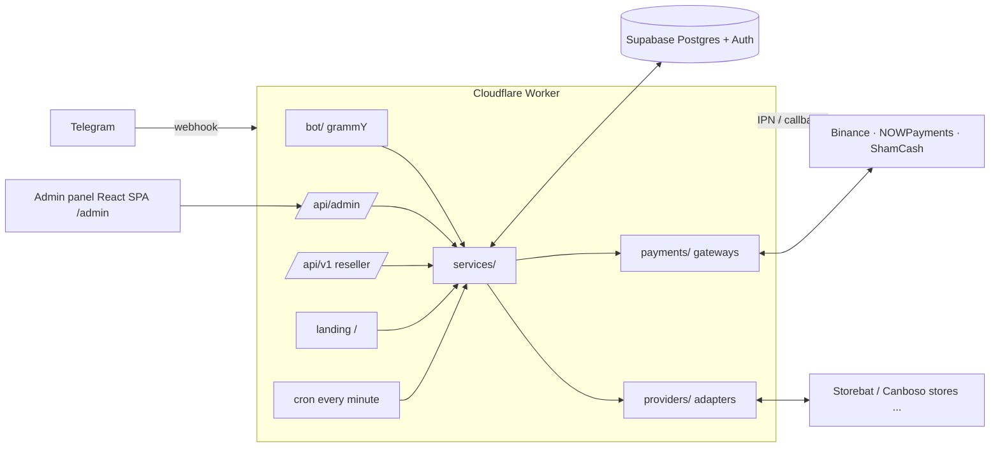

# Plus Store X

A white-label **Telegram store bot** for digital products (subscriptions, accounts, codes, links), with an
**admin panel** and a **landing page**. It runs entirely on **Cloudflare Workers**, with **Supabase** for the
database and admin login.

One codebase serves many stores: every store owner gets their own branch, GitHub repo, Cloudflare Worker and
Supabase project. Branding, texts, payments, providers and features are all configured from the admin panel.

## Features

**Customers (Telegram bot, English + Arabic)**
- Shop: categories → products → quantity → checkout, with colored buttons (Bot API 9.4 `style`).
- Custom animated emoji in messages and on buttons when the bot owner has Telegram Premium. Without Premium, plain emoji are used.
- Wallet in USD, with top-ups through **Binance Pay** (merchant), **Binance Pay ID** (personal transfer, verified with a read-only API key), **NOWPayments** (USDT BEP20) or **ShamCash** (manual proof, approved by an admin).
- Instant delivery from provider APIs or local stock, a "Download as TXT" button, and order history.
- Promo codes, wallet gift codes, referral bonus on friends' deposits, cashback points, personal and level discounts.
- Warranty: replacement and refund requests within the warranty period.
- Freebies, giveaways, a forced join to channels/groups, support center, and reseller API keys.

**Store owner (admin panel at `/admin`)**
- **Multi-provider catalog.** Each provider API is connected through an adapter. Storebat runs on the `ventebot` adapter; NovasGlobal and HitMeow run on `canboso`. More can be added.
- **Selective import.** Provider products are synced, and you choose which ones appear in the store. One store product can have several *sources* (provider A, provider B, local stock, manual), with routing by priority or lowest cost and automatic failover.
- **Edits survive sync.** Prices and stock always come live from the providers. Removed and new provider products are flagged.
- **Pricing.** Cost + markup % / fixed amount, or a manual price. Also sale %, quantity discounts and rounding rules.
- **Daily operations.** Local stock upload, manual-order queue, orders, refunds, tickets, deposits review, users and balances.
- **Content and messaging.** Broadcasts, bot text editor (EN/AR), emoji library, landing page editor.
- **Notifications** to an admin Telegram group: orders, failures, deposits, low stock, low provider balance, catalog changes.
- **Access.** Roles (`owner`, `support`) and an audit log.

## Architecture



More detail is in [docs/ARCHITECTURE.md](docs/ARCHITECTURE.md).

## Tech stack

| Layer | Tech |
|---|---|
| Runtime | Cloudflare Workers (TypeScript), Cron Triggers, optional Queues (paid plan) |
| Bot | [grammY](https://grammy.dev) |
| HTTP | [Hono](https://hono.dev) (+ `hono/jsx` for the landing page) |
| Database / auth | Supabase (Postgres, RLS deny-all, SQL functions for money operations; Supabase Auth for the admin panel) |
| Admin panel | React + Vite + Tailwind (built into `public/admin`) |
| CI/CD | GitHub Actions + Cloudflare Workers Builds |

## Repository layout

```
src/
  index.ts            Worker entry: routes, cron, queue consumer
  cron.ts             what runs every minute (sync, polling, giveaways, broadcasts)
  bot/                Telegram bot (handlers, keyboards)
  services/           business logic (catalog, pricing, orders, deposits, sync, ...)
  providers/          supplier API adapters (ventebot, canboso, ...)
  payments/           payment gateways (binance_pay, binance_id, nowpayments, shamcash)
  http/               admin API, reseller API, payment webhooks, landing page
  lib/                db, settings, crypto, i18n, emoji, telegram helpers, jobs
admin/                admin panel (React)
public/               static assets (logo) + built admin panel
supabase/
  migrations/         database schema (applied in order)
  seed.sql            demo data for local development only
  config.toml         local Supabase config
scripts/              dev-poll (local bot without webhook), gen-key
docs/                 setup guides
.github/workflows/    CI, client mirroring, database migrations
```

## Local development (laptop)

Requirements: Node 22+, Docker (for local Supabase), a test bot from @BotFather.

```bash
npm install
```

```bash
npm run db:start
```

`supabase start` prints the local API URL, `anon key` and `service_role key`.

```bash
cp .dev.vars.example .dev.vars
```

Fill in `.dev.vars`: the test bot token, the Supabase URL and keys from the previous step, and `ENCRYPTION_KEY` plus `TELEGRAM_WEBHOOK_SECRET` from:

```bash
npm run gen:key
```

```bash
npm run db:reset
```

This applies the migrations and loads the demo data (`supabase/seed.sql`).

```bash
npm run dev
```

The Worker runs on http://127.0.0.1:8787. In a second terminal:

```bash
npm run dev:poll
```

This forwards Telegram updates to the local Worker, so no public URL is needed. To work on the admin panel with hot reload:

```bash
npm run dev:admin
```

- Landing page: http://127.0.0.1:8787/
- Admin panel: http://127.0.0.1:8787/admin/. Run `npm run build` first. The demo login is in `supabase/seed.sql`.
- Supabase Studio: http://127.0.0.1:54323

> `dev:poll` removes the bot's webhook. Use a separate test bot rather than a store's production bot.

## Scripts

| Script | What it does |
|---|---|
| `npm run dev` | local Worker (`wrangler dev`) |
| `npm run dev:poll` | long-poll Telegram and forward updates to the local Worker |
| `npm run dev:admin` | admin panel dev server |
| `npm run build` | build the admin panel into `public/admin` |
| `npm run deploy` | build + `wrangler deploy` (normally Cloudflare Workers Builds does this) |
| `npm run typecheck` | TypeScript checks (worker + admin) |
| `npm test` | unit tests (vitest) |
| `npm run db:start` / `db:reset` / `db:push` | local Supabase / reset with seed / push migrations to a linked project |
| `npm run gen:key` | generate `ENCRYPTION_KEY` and `TELEGRAM_WEBHOOK_SECRET` |

## Docs

- [docs/SETUP-OWNER.md](docs/SETUP-OWNER.md) — for a store owner: bot, Supabase, GitHub, Cloudflare, first login.
- [docs/CLIENT-BRANCHES.md](docs/CLIENT-BRANCHES.md) — for the coder: one branch per client, and how updates reach each client automatically.
- [docs/BACKUPS.md](docs/BACKUPS.md) — daily encrypted database backups (GitHub Action) and how to restore.
- [docs/ARCHITECTURE.md](docs/ARCHITECTURE.md) — modules, data model, order lifecycle, security, and how to add a provider or payment gateway.
